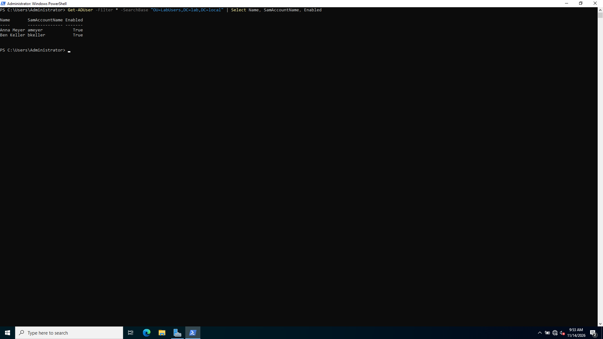
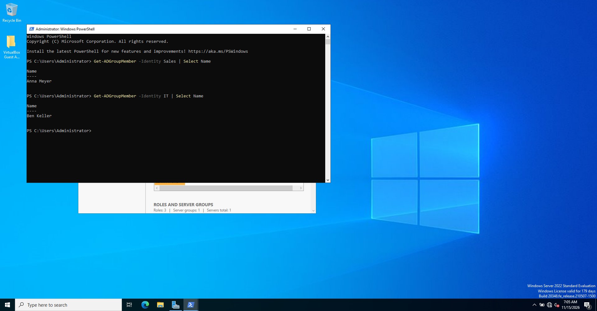
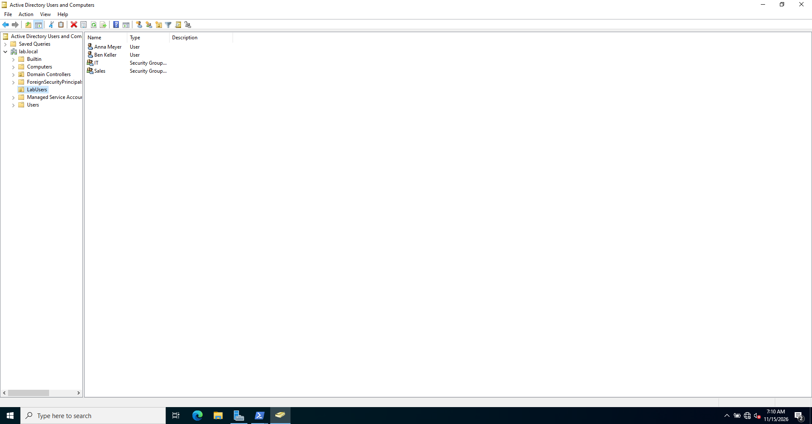
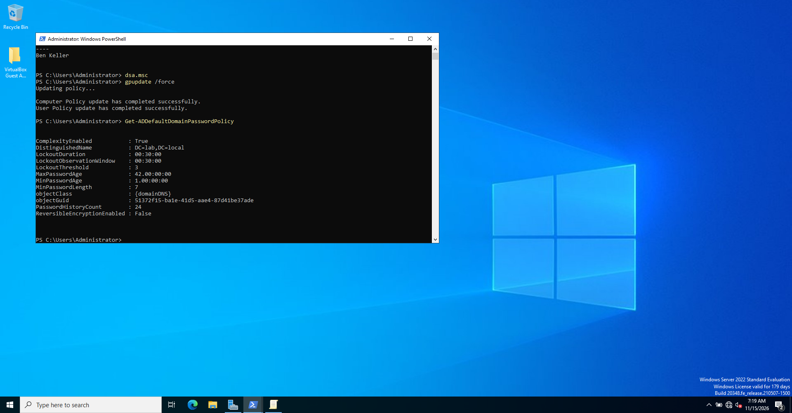
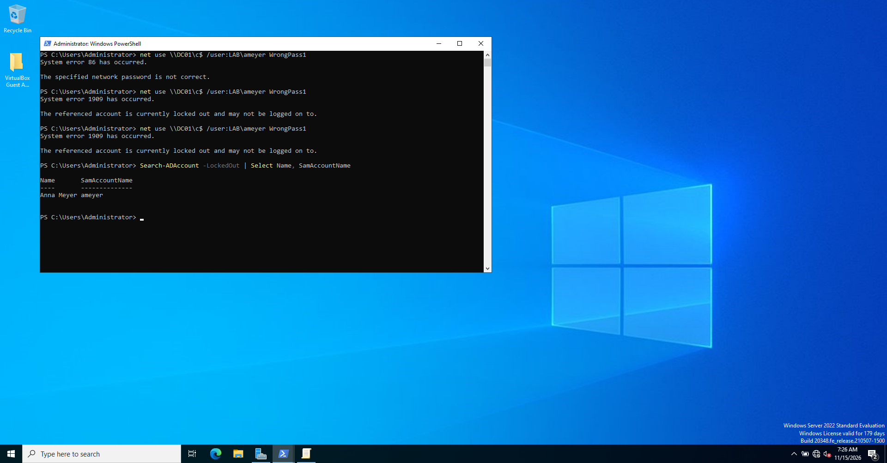
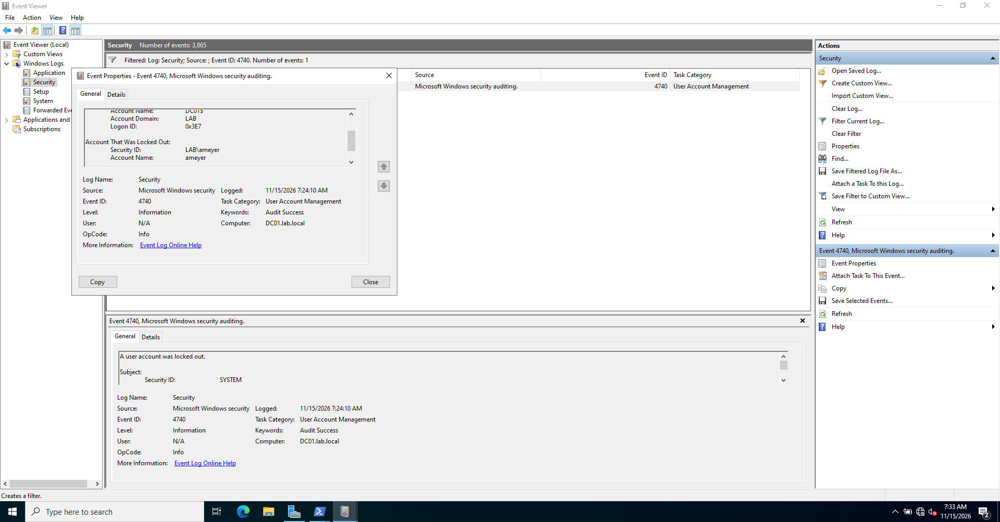
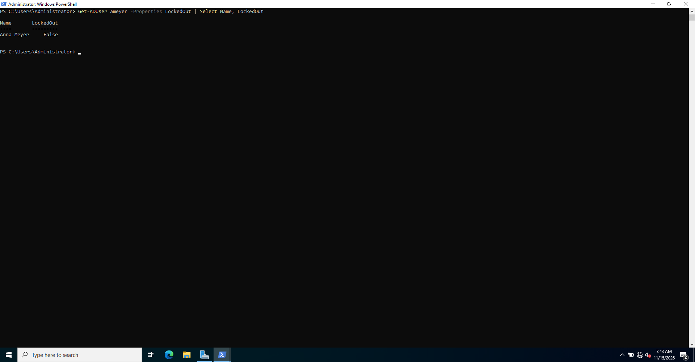

# Active Directory Home Lab

A small Windows Server 2022 domain built in VirtualBox to practise core Active Directory administration: domain setup, users and groups, an account lockout policy, and helpdesk-style lockout and password-reset handling.

## Environment

| Item | Value |
|---|---|
| Hypervisor | Oracle VirtualBox |
| Server OS | Windows Server 2022 Standard Evaluation (Desktop Experience) |
| Server name | DC01 |
| Domain | lab.local (NetBIOS: LAB) |
| Server IP | 192.168.10.10 / 255.255.255.0 (static, internal network `labnet`) |
| VM resources | 4 GB RAM, 2 CPUs, 50 GB disk |
| Networking | Adapter 1: Internal Network (`labnet`), Adapter 2: NAT for internet access |

## What I did

1. **Built the domain controller.** Installed Windows Server 2022, renamed it DC01, set a static IP with DNS pointing to itself, installed the AD DS role and promoted the server to a new forest (`lab.local`) with PowerShell.
2. **Created the directory structure.** One OU (`LabUsers`), two security groups (`Sales`, `IT`) and two users (`ameyer` in Sales, `bkeller` in IT), created with PowerShell.
3. **Configured an account lockout policy.** In the Default Domain Policy: lockout threshold of 3 invalid attempts, with 30 minutes for lockout duration and reset counter.
4. **Ran a lockout and password-reset exercise** (see below).
5. **Used snapshots** after the fresh install, after the domain promotion and after finishing the lab, so mistakes could be rolled back.

## Lockout and password-reset exercise (helpdesk-style ticket)

**Problem:** User Anna Meyer (`ameyer`) cannot log in.

**Diagnosis:**
- Reproduced the issue by entering a wrong password three times.
- Confirmed the account was locked with `Search-ADAccount -LockedOut`.
- Found the lockout event in Event Viewer (Security log, **Event ID 4740**).

**Resolution:**
```powershell
Unlock-ADAccount -Identity ameyer
Set-ADAccountPassword -Identity ameyer -Reset -NewPassword (Read-Host -AsSecureString "New password")
Set-ADUser -Identity ameyer -ChangePasswordAtLogon $true
```
Verified with `Get-ADUser ameyer -Properties LockedOut` that the account was unlocked, and forced a password change at next logon.

## Screenshots

| Step | Screenshot |
|---|---|
| Users in the LabUsers OU |  |
| Groups and members |  |
| Active Directory Users and Computers |  |
| Lockout policy |  |
| Login error after 3 failed attempts |  |
| Locked account in AD |  |
| Event ID 4740 |  |
| Account unlocked |  |

## Problems and lessons learned

- **Forgot the Administrator password** during the first install and rebuilt the VM. Lesson: note down lab passwords and take a snapshot right after installation.
- **Copy and paste did not work** in the VM until I installed VirtualBox Guest Additions and enabled the shared clipboard.
- **Performance:** running the VM and a browser together was slow on my PC, so I lowered resources and prepared commands in a text file first.
- **Static IP:** the server has two adapters, so I had to identify the internal one (`labnet`) and leave the NAT adapter on DHCP.

## Next steps

- Join a Windows 10/11 client to the domain and repeat the lockout with real logins.
- Add Group Policy objects per OU (wallpaper, restrictions).
- Create a shared folder with permissions based on group membership.
- Bulk-create users from a CSV with PowerShell.
- Explore hybrid identity (Microsoft Entra Connect).

> This is a lab environment. All accounts and passwords are test data.
